# Hafta 5: Akış Diyagramları: Semboller, Analiz ve Tasarım - II

## 1. Giriş ve Ön Hazırlık
Geçtiğimiz hafta akış diyagramı dünyasına ayak basmış, standart sembollerimizle (Elips, Eşkenar Dörtgen, Dikdörtgen) basit karar ve sıralı kodlamaların diyagram şemalarını incelemiştik. 

Hafta 3'te "Algoritma 2" konusunda Döngü (Tekrar) mekanizmalarını da sözel metin olarak çalıştık ama işin resmi haline dökmedik. O yüzden, bu 5. haftamızda özellikle Algoritmadaki en zorlayıcı olgu olan **Döngü ve Karmaşık İç İçe Karar** yapılarını "Akış Diyagramlarıyla" görselliğe aktarmaya odaklanacağız. 

**Hedefler:**
- Oku alıp geriye göndererek "Döngü (Loop)" akışını diyagramlaştırmak.
- Sayaç (Counter) ve Toplam mekanizmalarının geometrik yansımalarını öğrenmek.
- İki veya daha fazla karar (şart/Eşkenar Dörtgen) bağlanan durumlarda çoklu yolları idare etmek.

---

## 2. Döngüleri Diyagrama Dökmek Üzerine Ön Bilgi
Sıralı algoritmaların diyagramlarındaki oklar hep aşağı akar veya sağa / sola seker en nihayetinde de "Bitir" topunda birleşirdi. 
**Döngülü** akış şemalarında da karar oklarından biri (Genelde "Evet, daha döngü bitmedi" okudur bu), sürecin aşağıya akan mekanizmasına veda eder, *çizgi yukarı doğru seyrederek eski bir dikdörtgenin başına tekrar bağlanır.*

Döngünün sonsuza girmemesi için daima araya bir "Sayaç" koymalı ve her turda onu 1 attırmak üzere işlem satırını araya sıkıştırmalıyız. Karar şartı her turda bu sayacın son limiti aşıp aşmadığını test edip "Aşmadıysa Devam Et", "Aştıysa Döngüden Çık ve Bitir" denmelidir.

---

## 3. Akış Diyagramı Tasarım Örnekleri (Döngü / İleri Kararlar)

İlk olarak döngü ve sayaç mantığını gösteren 3 örnek, ardından `for` döngüsünün akış diyagramındaki altıgenlerle gösterildiği 5 basit örnek ele alınmıştır.

### ÖRNEK 1: Ekrana 5 Kere "Merhaba Dünya" Yazdıran Döngü Algoritması
Yazılım serüvenlerinde "10 kere tekrar et" komutunu diyagramla ifade edeceğiz. Klasik mantıkla art arda 5 tane çıktı diktörtgeni çizebilecek olmamıza rağmen, ya 100.000 kere istenirse diye döngü sistemini kullanacağız.

**Algoritma Adımları:**
1. Başla
2. Adim isimli değişkene 1 ataması yap (Adım sayacı)
3. Ekrana "Merhaba Dünya" çıkışını ver.
4. Adim = Adim + 1 yap
5. Eğer Adim <= 5 ise Adım 3'e GİT. (Büyükse Adım 6'ya devam et)
6. Bitir.

**Akış Diyagramı Şeması:**
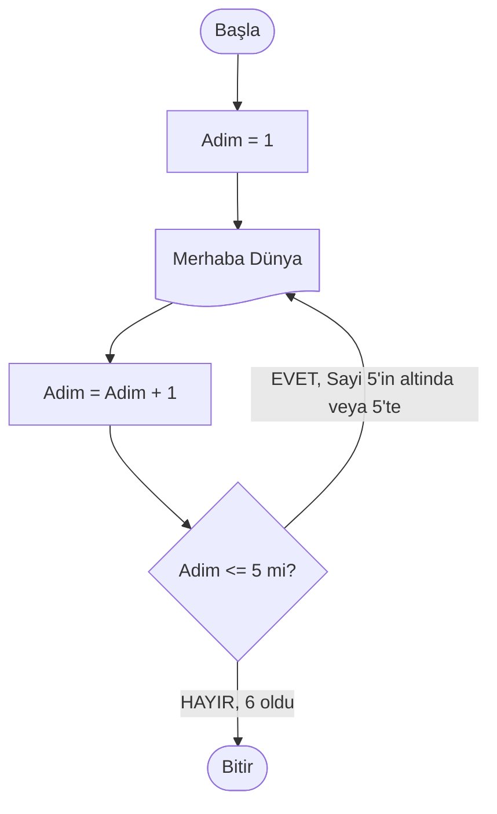
*Açıklama:* Dikkat ettiyseniz, E harfinden çıkan "Evet" cevabı, algoritmayı bitirmiyor ve yukarı, C'nin bulunduğu noktaya tekrar bir Ok yolluyor. İşte kodlama dünyasında döngü denilen kısım bu yukarı giden optur; şart bitene kadar burada bir hortum oluşacaktır.

---

### ÖRNEK 2: Kullanıcı Tarafından Belirlenen N Sayısına Kadar Toplam Bulma (1'den N'ye) 
Diyelim ki programı çalıştıran kişi sisteme 4 sayısını yazdı. Program 1+2+3+4 hesaplayacak ve bulduğu 10 sayısını çıktı olarak kullanıcıya gösterecek. Limitimiz klavyeden belirleniyor.

**Algoritma Adımları:**
1. Başla.
2. Dışarıdan hedeflenen limit olan sayı girişini (`N`) iste.
3. Arka plan hafızasında `Tur=1` ve `Toplam=0` değişkenlerini yarat.
4. `Toplam = Toplam + Tur` (0 olan toplama, turun değerini aktar).
5. `Tur = Tur + 1` (Turu bir sonraki aşamaya çek, yani 2 yap vb.)
6. Püf Noktası – Soru Sor: `Tur <= N` değerine hala uygun mu? Doğruysa 4. adıma geri fırlat.
7. Eğer şart ihlal edildiyse, ekrana `Toplam`ı gönder.
8. Bitir.

**Akış Diyagramı Şeması:**
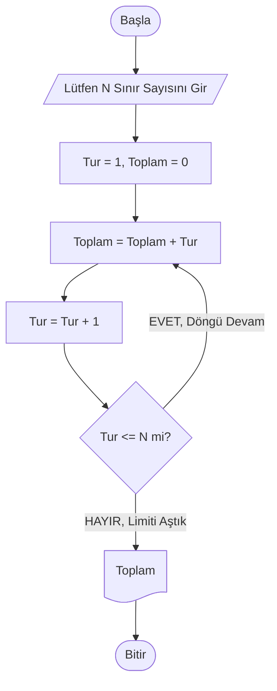
*Açıklama:* Tur değeri limit sayısını her bir arttırdığında D e bağlanan koca bir tur çemberine girer. Limit aşıldığında sistem çemberi kollarından kopararak Hayır okunu seçer ekrana skoru yazar. Döngü ile Karar mekanizmasının sanatına harika bir taslaktır.

---

### ÖRNEK 3: Kullanıcı Pozitif veya Sıfır Girdiği Sürece Girdiği Sayıları Toplayan Sistemin Akış Şeması
Bu örnek, yazılımda "Sonsuz Döngüye veya Şarta Bağlı Döngüye (While)" örnektir. Limiti önceden bilmeyiz, tek derdi; "Kullanıcı önüne gelen ekrana Eksi (-) sayılar (-4 gibi) girmediği SÜRECE" işlemi tekrarlatıp yazılan sayıları kumbaraya atsın, kullanıcı negatif girer girmez o sayıyı almayıp eskilerin tüm toplamını verip işlemi kırsın (programı bitirsin).

**Algoritma Adımları:**
1. Başla.
2. Hafızada Toplam değerine sıfır ver (`Toplam=0`).
3. Dışarıdan Sayı İste.
4. Girilen `Sayi >= 0` mı sorusunu Karara bağla.
5. Eğer Sıfır'dan büyük/eşitse (Şart Tutuyorsa): 
   `Toplam = Toplam + Girilen Sayi` formülünü yap.
    Ardından yine Adım 3'e çık, yeni bir sayı girmesini iste (Yine Karara gelsin vb).
6. Eğer Sıfır'dan değil, Eksiyse (negatif-şart tutmuyorsa): 
   O koldan kop, Ekrana "Su Ana Kadar Girilen Toplamınız= Toplam", yazdır.
7. Bitir.

**Akış Diyagramı Şeması:**
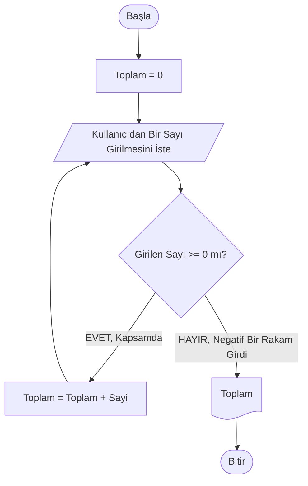
*Açıklama:* Bu döngümüzde net bir 'Sayac = Sayac+1' durumu yok, şart kullanıcıya bağlandı. Kullanıcı klavyeden -5 yazmadığı müddetçe, sistem sonsuza kadar onu (C) aşamasıyla (E) aşaması arasında defalarca çalışabilecek bir kafesin içerisine attı. Yazılımların interaktif olarak insana hizmet etmesini saplayan kilit prensip buradaki diyagramdır.

---

### For Döngüsünü Altıgenlerle Gösterme

Akış diyagramında altıgen (hazırlık sembolü) `for` döngüsünün tamamını tek kutuda gösterir: `başlangıç; şart; artış`. Ayrıca karar eşkenar dörtgeni veya sayaç artırma kutusu çizilmez. Şart doğruysa döngü gövdesi çalışır ve ok altıgene geri döner (sayaç otomatik artar); şart yanlışsa döngüden çıkılır.

### ÖRNEK 4: 1'den 5'e Kadar Sayıları Yazdırma

Sayaç 1'den başlar. 5'i aşmadığı sürece ekrana yazdırılır ve bir artırılır.

**Algoritma Adımları:**
1. Başla.
2. `i = 1` yap (sayaç başlangıcı).
3. `i <= 5` şartını kontrol et. Şart yanlışsa Adım 6'ya git.
4. Ekrana `i` değerini yazdır.
5. `i = i + 1` yap ve Adım 3'e dön.
6. Bitir.

**Akış Diyagramı:**
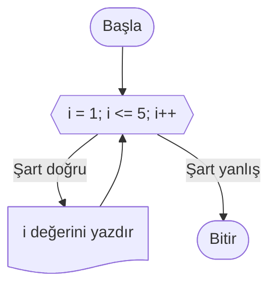

### ÖRNEK 5: 1'den 5'e Kadar Sayıların Toplamını Bulma

Her turda sayaç toplam değişkenine eklenir. Döngü bitince toplam ekrana yazdırılır.

**Algoritma Adımları:**
1. Başla.
2. `toplam = 0` yap.
3. `i = 1` yap (sayaç başlangıcı).
4. `i <= 5` şartını kontrol et. Şart yanlışsa Adım 7'ye git.
5. `toplam = toplam + i` yap.
6. `i = i + 1` yap ve Adım 4'e dön.
7. Ekrana `toplam` değerini yazdır.
8. Bitir.

**Akış Diyagramı:**
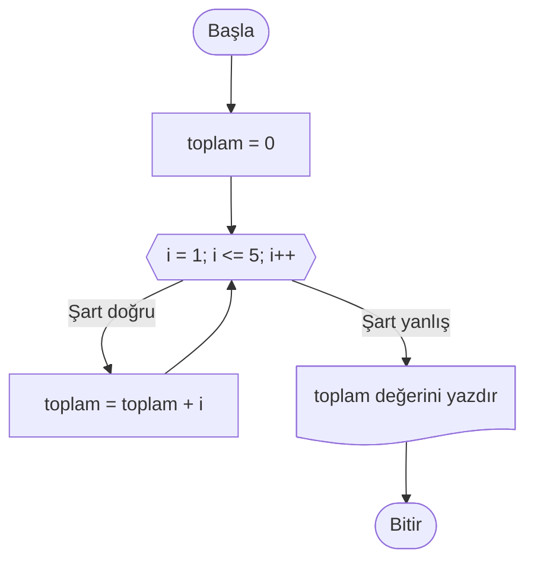

### ÖRNEK 6: Tek Sayıları Yazdırma

1'den başlayıp sayacı her turda 2 artırarak 9'a kadar olan tek sayılar yazdırılır.

**Algoritma Adımları:**
1. Başla.
2. `sayi = 1` yap.
3. `sayi <= 9` şartını kontrol et. Şart yanlışsa Adım 6'ya git.
4. Ekrana `sayi` değerini yazdır.
5. `sayi = sayi + 2` yap ve Adım 3'e dön.
6. Bitir.

**Akış Diyagramı:**
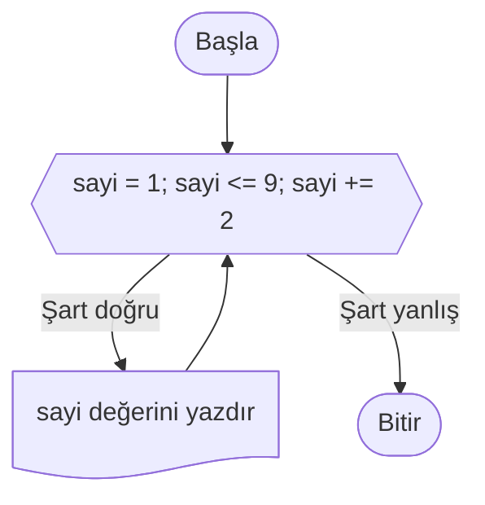

### ÖRNEK 7: 3'ün Çarpım Tablosunu Yazdırma

Sayaç 1'den 5'e kadar ilerler; her turda 3 ile sayacın çarpımı yazdırılır.

**Algoritma Adımları:**
1. Başla.
2. `i = 1` yap (sayaç başlangıcı).
3. `i <= 5` şartını kontrol et. Şart yanlışsa Adım 6'ya git.
4. Ekrana `3 * i` değerini yazdır.
5. `i = i + 1` yap ve Adım 3'e dön.
6. Bitir.

**Akış Diyagramı:**
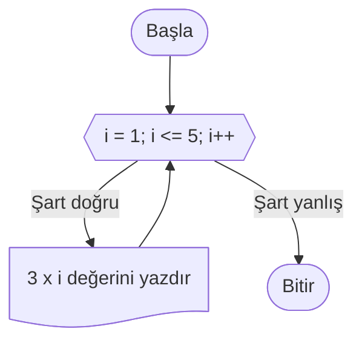

### ÖRNEK 8: 5 Sayısının Faktöriyelini Hesaplama

Sayaç 1'den 5'e kadar ilerler ve her turda çarpım sonucuna eklenir. Döngü sonunda `5! = 120` bulunur.

**Algoritma Adımları:**
1. Başla.
2. `faktoriyel = 1` yap.
3. `i = 1` yap (sayaç başlangıcı).
4. `i <= 5` şartını kontrol et. Şart yanlışsa Adım 7'ye git.
5. `faktoriyel = faktoriyel * i` yap.
6. `i = i + 1` yap ve Adım 4'e dön.
7. Ekrana `faktoriyel` değerini yazdır.
8. Bitir.

**Akış Diyagramı:**
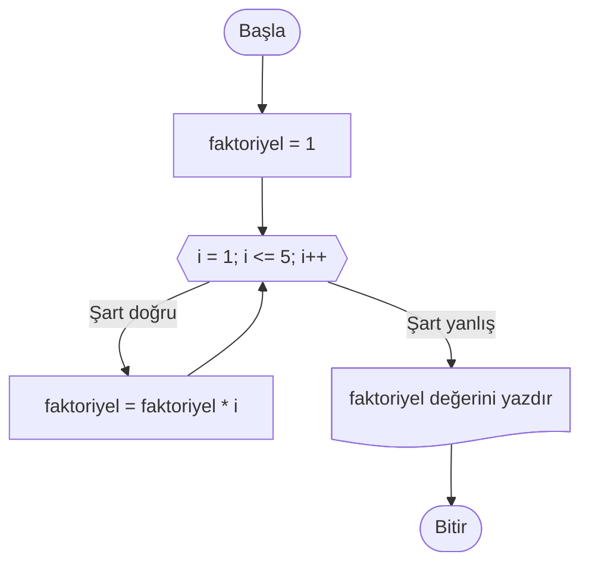

---

### Orta Seviye Döngü Soruları (For / While)

Çizim kuralları: Döngü şartı (`for` için başlangıç; şart; artış) altıgenin içinde yazılır, ayrıca eşkenar dörtgen çizilmez. Eşkenar dörtgen yalnızca döngü içindeki gerçek `if` kararlarında kullanılır. Ekrana yazdırma `doc` şekliyle, klavyeden okuma paralelkenarla gösterilir.

### SORU 1: 1'den 10'a Kadar Çift Sayıların Toplamı (For + Karar)

1'den 10'a kadar sayıları gezin, yalnızca çift olanları toplayın ve toplamı yazdırın. (Sonuç: 30)

**Algoritma Adımları:**
1. Başla.
2. `toplam = 0` yap.
3. `i = 1` yap (sayaç başlangıcı).
4. `i <= 10` şartını kontrol et. Şart yanlışsa Adım 8'e git.
5. `i` çift mi kontrol et. Çift değilse Adım 7'ye git.
6. `toplam = toplam + i` yap.
7. `i = i + 1` yap ve Adım 4'e dön.
8. Ekrana `toplam` değerini yazdır.
9. Bitir.

**Akış Diyagramı:**
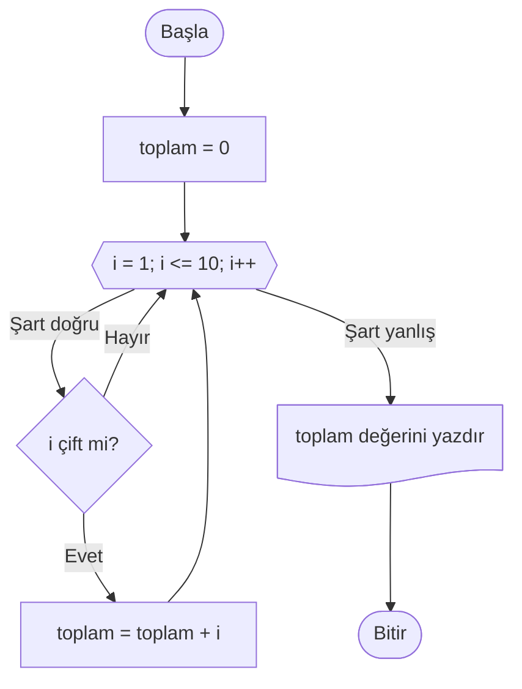

### SORU 2: N'e Kadar Sayıların Karelerini Yazdırma (For)

Kullanıcıdan N değerini alın. 1'den N'e kadar her sayının karesini ekrana yazdırın. (N = 4 için: 1, 4, 9, 16)

**Algoritma Adımları:**
1. Başla.
2. Kullanıcıdan `N` sayısını al.
3. `i = 1` yap (sayaç başlangıcı).
4. `i <= N` şartını kontrol et. Şart yanlışsa Adım 7'ye git.
5. Ekrana `i * i` değerini yazdır.
6. `i = i + 1` yap ve Adım 4'e dön.
7. Bitir.

**Akış Diyagramı:**
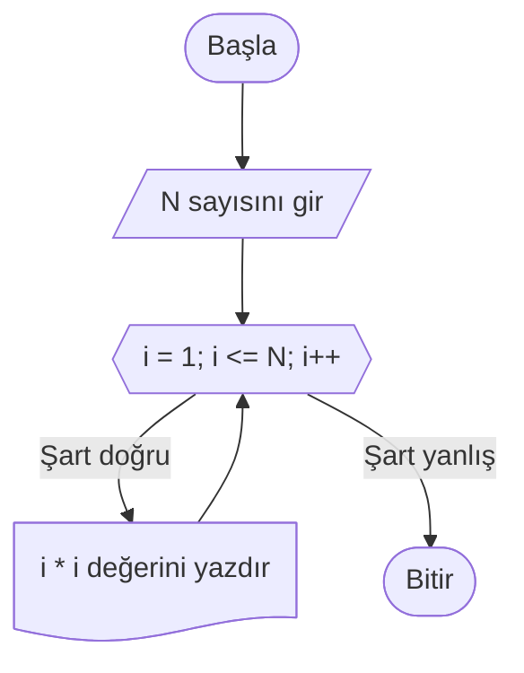

### SORU 3: Bir Sayının Basamak Sayısını Bulma (While)

Kullanıcının girdiği pozitif tam sayının kaç basamaklı olduğunu bulun. Sayı her turda 10'a tam bölünerek küçültülür. (1254 için: 4)

**Algoritma Adımları:**
1. Başla.
2. Kullanıcıdan `n` sayısını al.
3. `sayac = 0` yap.
4. `n > 0` şartını kontrol et. Şart yanlışsa Adım 7'ye git.
5. `sayac = sayac + 1` yap.
6. `n = n / 10` yap (tam bölme) ve Adım 4'e dön.
7. Ekrana `sayac` değerini yazdır.
8. Bitir.

**Akış Diyagramı:**
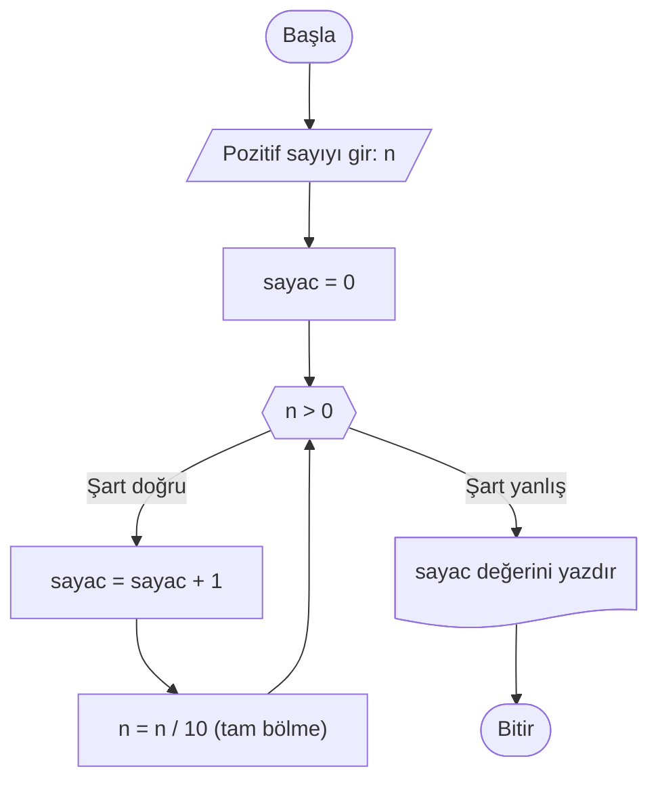

### SORU 4: 0 Girilene Kadar Sayıların Ortalamasını Bulma (While + Karar)

Kullanıcı 0 girene kadar sayı almaya devam edin. 0 girildiğinde (0 hariç) girilen sayıların ortalamasını yazdırın. Hiç sayı girilmediyse ortalama hesaplanmaz.

**Algoritma Adımları:**
1. Başla.
2. `toplam = 0` ve `adet = 0` yap.
3. Kullanıcıdan `sayi` değerini al.
4. `sayi != 0` şartını kontrol et. Şart yanlışsa Adım 8'e git.
5. `toplam = toplam + sayi` yap.
6. `adet = adet + 1` yap.
7. Kullanıcıdan yeni `sayi` değerini al ve Adım 4'e dön.
8. `adet > 0` mı kontrol et. Değilse Adım 10'a git.
9. Ekrana `toplam / adet` değerini yazdır ve Adım 11'e git.
10. Ekrana "Sayı girilmedi" yazdır.
11. Bitir.

**Akış Diyagramı:**
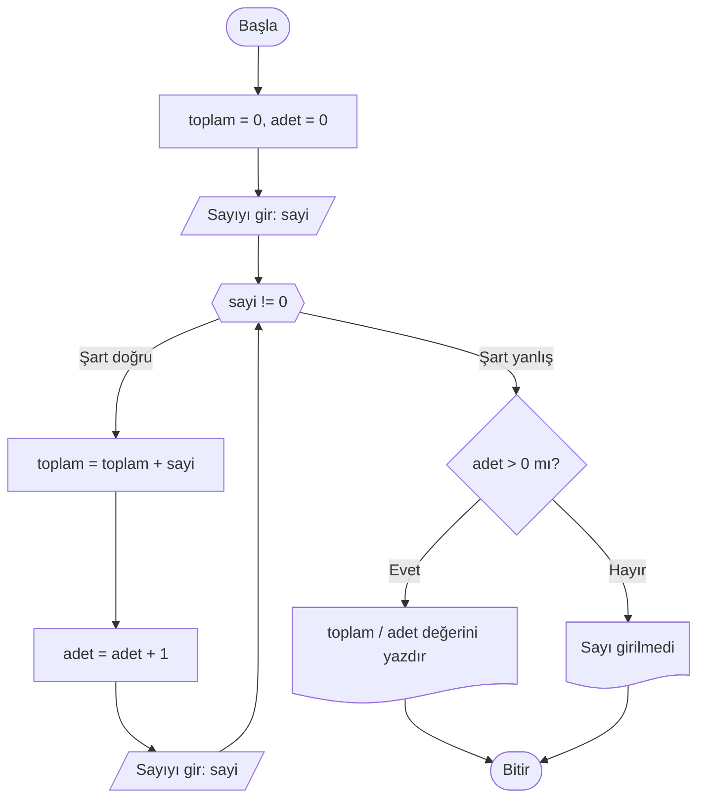

### SORU 5: İlk 8 Fibonacci Sayısını Yazdırma (For)

Fibonacci dizisinde her sayı, kendinden önceki iki sayının toplamıdır. İlk 8 terimi yazdırın. (0, 1, 1, 2, 3, 5, 8, 13)

**Algoritma Adımları:**
1. Başla.
2. `a = 0` ve `b = 1` yap.
3. `i = 1` yap (sayaç başlangıcı).
4. `i <= 8` şartını kontrol et. Şart yanlışsa Adım 9'a git.
5. Ekrana `a` değerini yazdır.
6. `c = a + b` yap.
7. `a = b` ve `b = c` yap.
8. `i = i + 1` yap ve Adım 4'e dön.
9. Bitir.

**Akış Diyagramı:**
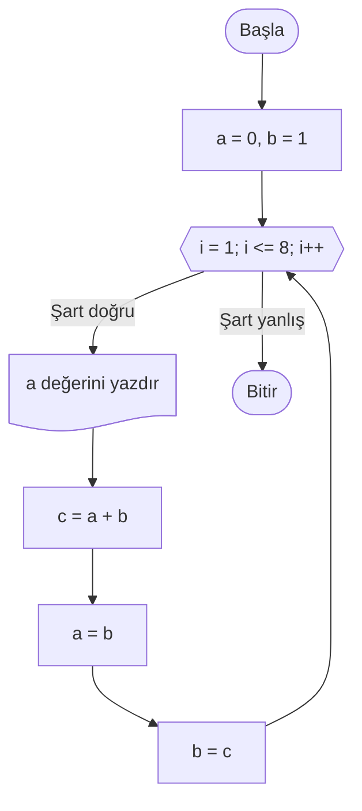

---

## 4. Haftalık Özet
Beşinci haftamızı tamamlarken, artık herhangi bir kod komutu görmemiş olsanız bile bilgisayarların hangi mantıkla milyarlarca satır döngüyü sıfır hata ile çözdüğünün matematiksel "Düşünce" yapısına hakimsiniz. Bu diyagramları tasarlamak işin C, Python, C# ile kod yazma kısmından her daim daha önemlidir! Mimariyi iyi çizersek, ustalıkla tuğlaları üzerine ekleriz.

**Alıştırma Sorusu:**
1. Kendinize ait bir "Faktöriyel Hesaplayan" (Girilen 5 sayısı için 5x4x3x2x1 yapan algoritma) Akış Diyagramını defterinize paralel, kare, eşkenar çokgen ve okları kullanarak kendi limitlerinizle çizmeye çalışın...
2. İkinci soruyu düşünün: Herhangi bir Akış diyagramında Eşkenar dörtgenden "Çıkan Oklardan İkisi Birden (Hem Evet Hem Hayır)" tek bir noktada tekrar birleştirilebilir mi neden?
